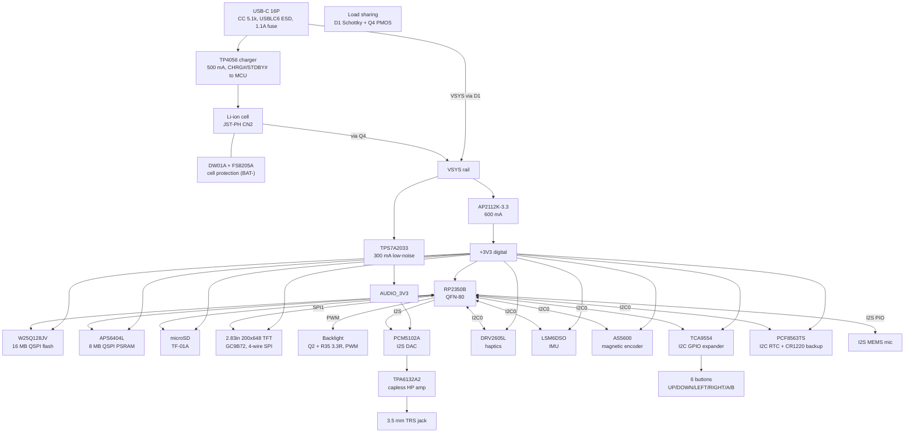

# Solace

A pocket-sized, battery-powered **hi-fi music player** built around the Raspberry Pi
**RP2350B**. Music files live on a microSD card, decode on the MCU, and go out through a
**PCM5102A** DAC and a **TPA6132A2** capless headphone amplifier to a 3.5 mm jack. A
2.83″ 200×648 SPI TFT shows the UI, a **DRV2605L** drives haptics, and an IMU, a magnetic
encoder and six buttons provide input. A **PCF8563TS** real-time clock keeps time on a
coin cell, and an **I²S MEMS microphone** supports capture and voice-driven mini-games.

This document is the project's single source of truth for **what the hardware is, how it
is put together, and what is still open**.

- **Status:** schematic complete and netlist-verified. **Board outline drafted, no placement yet.**
- **EDA:** KiCad 10.0
- **Intended build:** single-sided PCB (see [§14](#14-known-limitations--open-items))

---

## 1. Scope

**In scope**

- Portable, battery-powered audio playback (local files on microSD).
- 2.83″ colour display with software-adjustable brightness.
- Wired headphone/earbud output.
- Haptic feedback, motion sensing, rotary navigation (magnetic encoder), 6 tactile buttons.
- I²S MEMS microphone for capture and mini-games.
- Real-time clock with CR1220 backup (SMT holder, single-sided assembly).
- USB-C charging with power-path so the device runs while charging.
- Firmware-visible battery voltage, battery temperature, and charger state.

**Out of scope / not present**

- No speaker, no Bluetooth/Wi-Fi (no radio of any kind).
- No software in this repository — this is the hardware design only.
- No PCB layout beyond the drafted 100 × 64 mm outline (see [§14](#14-known-limitations--open-items)).

---

## 2. Repository layout

| Path | Contents |
|---|---|
| `main.kicad_sch` | The complete schematic (single flat sheet) |
| `main.kicad_pro` | KiCad project settings |
| `main.txt` | Netlist, `kicadsexpr` format — **generated**, do not hand-edit |
| `main.csv` | BOM — **generated/curated**, grouped by value + footprint |
| `main.kicad_pcb` | **Board file: 100 × 64 mm outline, 4-layer stackup.** No placement or routing yet |
| `docs/Solace_Hardware_Design_Documentation_RevB.pdf` | Design documentation package: architecture, electrical specification, interfaces, BOM appendix and the schematic as an A2 fold-out |
| `tools/build_docs.py` | Regenerates that PDF from `main.csv`, `main.txt` and `main.kicad_sch` |
| `libs/lcsc/` | Imported LCSC symbols, footprints and 3D models |
| `ganyu.kicad_sym`, `ganyu.kicad_mod` | Local custom symbol/footprint library |
| `docs/datasheets/rp2350/` | RP2350 datasheet + *Hardware design with RP2350* |
| `docs/datasheets/panels/` | Panel datasheets (C14 14-pin, H12 12-pin, CON8 8-pin variants) |
| `docs/mechanical/` | Enclosure sketch (`rough-sketch.png`, `.pdn`) |
| `fabrication/jlcpcb/` | JLCPCB fabrication output and project database |
| `fabrication/gerbers/` | Gerber and drill export plus job file |
| `backups/` | Manual schematic snapshots, earlier BOM/netlist, superseded PDFs |
| `backups/kicad-autosave/` | Timestamped KiCad auto-backup ZIPs |
| `backups/stray-main.kicad_pcb/` | Archived stray folder that previously shadowed the board filename |

> `main.kicad_pcb` currently contains **only the board outline** (Edge.Cuts, 100 × 64 mm,
> 3 mm corner radius) plus the 4-layer stackup. It has no footprints, so the first
> *Update PCB from Schematic* will drop in all 159 parts cleanly.

---

## 3. System architecture



---

## 4. Compute, memory, clock

| Item | Part | Notes |
|---|---|---|
| MCU | **RP2350B** (QFN-80), LCSC `C42415655` | All GPIOs 0–47 available |
| Program flash | **W25Q128JVSIQ** 128 Mbit (16 MB) QSPI, `U17` | Shares the QSPI bus |
| PSRAM | **APS6404L-3SQR** 64 Mbit (8 MB) QSPI, `U1` | Chip-select on **GPIO0** (`XIP_CS1n`), separate from flash CS |
| Crystal | **ABM8-272-T3** (12 MHz), `U18` | The Pico/Pico 2 crystal; 15 pF load caps `C61`/`C62`, 1 kΩ series `R23` |
| Core supply | RP2350 internal buck | 3.3 µH `AOTA-B201610S3R3-101-T` (`L10`) → `+1V1`, `C58` 10 µF + `C59` 1 µF |
| Regulator analog supply | `VREG_AVDD` | 33 Ω (`R41`) + 4.7 µF (`C60`), per the RP2350 reference design |

The core-rail network (inductor part number, `VREG_AVDD` RC filter) is copied **exactly**
from *Hardware design with RP2350* — including the Abracon inductor, which is a polarised
part. **Layout note:** the inductor's polarity dot must be oriented as in the reference
design, or regulator instability results.

**Debug:** `J3`, 3-pin SWD header (SWDIO/SWCLK/GND) + `SW12` BOOTSEL + `SW11` RUN.

---

## 5. Power

### 5.1 Topology

```
USB-C ──F3 1.1A──┬── TP4056 (U2) ──► BAT+ ──► cell (CN2)
                 │        │
                 │        └──► DW01A + FS8205A protection in the BAT- path
                 │
                 └──D1 (B5819WS)──► VSYS ◄──Q4 (AO3401A)── BAT+
                                       │
                                       ├── AP2112K-3.3 (U4) ──► +3V3  (digital)
                                       └── TPS7A2033 (U5)  ──► AUDIO_3V3 (audio)
```

### 5.2 Charger

| Parameter | Value |
|---|---|
| Charger | **TP4056** (`U2`), ESOP-8 |
| Charge current | **500 mA** (`R5` = 2.4 kΩ, I = 1200/R) |
| `CE` | Driven by `CHARGE_EN` (see below) |
| `CHRG#` | → **GPIO18**, 10 kΩ pull-up `R13`. Active-low: charging in progress |
| `STDBY#` | → **GPIO22**, 10 kΩ pull-up `R49`. Active-low: charge complete |
| `TEMP` | Tied to GND — the TP4056's own thermal cut-out is **disabled** |

### 5.3 Load sharing (power path)

`BAT+` feeds only the cell, the protection FETs, the charger and the fuel-gauge divider.
The system is fed from **`VSYS`**, which is whichever of USB or battery is present:

| Ref | Part | Role |
|---|---|---|
| `D1` | B5819WS Schottky | USB → `VSYS`, blocks battery back-feed into the USB port |
| `Q4` | AO3401A PMOS | `BAT+` → `VSYS`; **source on `VSYS`, drain on `BAT+`** so the body diode can never let USB charge the cell |
| `R44` | 100 Ω | Gate pull-up to `USB_5V` |
| `R45` | 100 kΩ | Gate pull-down |
| `C66` | 22 µF | `VSYS` bulk |
| `C67` | 10 µF | `BAT+` / charger output |

Behaviour: USB present → gate ≈ 5 V vs. a 4.65 V source, Vgs ≈ +0.35 V → **Q4 off**, cell
disconnected from the load, charger termination works correctly. USB absent → gate 0 V,
Vgs = −V<sub>BAT</sub> → **Q4 on**.

### 5.4 Regulators

| Rail | Regulator | Load |
|---|---|---|
| `+3V3` | AP2112K-3.3 (`U4`), 600 mA | MCU I/O, flash, PSRAM, SD, display, backlight, haptics, sensors, expander |
| `AUDIO_3V3` | TPS7A2033 (`U5`), 300 mA, low-noise | DAC + amplifier |

`AUDIO_3V3` is split per domain through ferrites `L5`–`L8` into the PCM5102A's `AVDD`,
`CPVDD`, `DVDD` and the amplifier's `VDD`.

**Power switch:** `SW5` (slide) connects `VSYS` to `LDO_ENABLE`, which drives both
regulators' `EN` pins; `R10` (100 kΩ) holds them off when the switch is open. The
regulators' inputs are always live, so only their quiescent current is drawn when "off".

### 5.5 Charger control (firmware)

`CE` is not tied to USB — firmware can stop charging:

```
USB_5V ──R47 10k──┬── U2.CE
                  └── Q5.D (AO3400A)   S → GND
                       G ──R48 100k── GND
                       G ── CHARGE_CTL ── GPIO21
```

| State | `CHARGE_CTL` | Q5 | `CE` | Charging |
|---|---|---|---|---|
| MCU off / power switch open | floating | off (R48) | 5 V via R47 | **enabled** |
| Boot, before init | high-Z | off | 5 V | **enabled** |
| Allow | driven low | off | 5 V | enabled |
| Cut | driven high | on | 0 V | **disabled** |

Fail-safe by construction: a dead MCU or a hung boot can never leave the device unable to
charge. The MCU pin only drives a gate, so 5 V never reaches the RP2350.

### 5.6 Battery monitoring

| Quantity | Sense | Notes |
|---|---|---|
| Pack voltage | `R24` 220 k / `R28` 100 k → **GPIO40 / ADC0**, `C25` 100 nF | 4.2 V → 1.31 V |
| Cell temperature | `J2` external NTC + `R46` 10 k to `+3V3`, `C68` 100 nF → **GPIO44 / ADC4** | 10 k NTC, B = 3950 |

Temperature is referenced to the regulated `+3V3`, so it reads correctly **whether or not
USB is connected**. The NTC is **off-board** (`J2`): it must be bonded to the cell, not
mounted on the PCB, and the 100 nF at the connector keeps the ADC stable over the lead
length.

---

## 6. Display

| Item | Value |
|---|---|
| Panel | **ZJY283-2064KIWPG03-C14** — 2.83″, 200×648, normally black, all-view |
| Driver IC | **GC9B72** |
| Interface | 4-wire SPI (write-only — no SDO, no TE on this variant) |
| Connector | `U9` **KH-FG0.5-H2.0-14P-SMT**, 14-pin 0.5 mm FPC, H = 2.0 mm, LCSC `C5441651` |
| FPC | 0.5 mm pitch, `PI+FPC = 0.3 ± 0.03 mm` |

| Panel pin | Signal | MCU |
|---|---|---|
| 1 | GND | — |
| 2 | RESET | GPIO7 |
| 3 | SCL | **GPIO10** (SPI1 SCK) |
| 4 | D/C | GPIO8 |
| 5 | CS | **GPIO9** (SPI1 CSn) |
| 6 | SDA | **GPIO11** (SPI1 TX) |
| 7 | NC | — |
| 8 | GND | — |
| 9 | VDD | `+3V3` |
| 10 | LEDK | backlight cathode |
| 11, 12 | GND | — |
| 13, 14 | NC | — |

SPI mode **0 or 3** (the panel latches SDA on the SCL rising edge). CS and RESET are
active-low. Hardware `SPI1` is used for all three of SCK/MOSI/CS.

**Local decoupling:** `C63` 1 µF at the panel's VDD pin.

### 6.1 Backlight

`+3V3` → (LED anodes, tied internally to VDD) → LEDK → `R35` **3.3 Ω** → `Q2` (AO3400A,
low-side) → GND. Gate on **GPIO6**, pulled down by `R36` 10 kΩ (default off).

Brightness is **PWM on GPIO6** — GPIO6's alternate function 4 is **PWM3 A**, so a hardware
PWM slice drives the gate directly. Use 10–20 kHz; average LED current ≈ duty × ~95 mA.

> **Backlight limitation — please read §14.1.** The C14 variant has **no LEDA pin**; the
> LED anodes are internally tied to VDD, so the string only ever sees 3.3 V against a
> V<sub>F</sub> of ≈3.0–3.2 V. Rated brightness (120 mA / 350 cd/m²) is **not reachable**
> from this rail.

---

## 7. Audio

```
RP2350 I2S ──► PCM5102A (U6) ──470R──► TPA6132A2 (U11) ──► PJ-342 jack (CN1)
 BCK  GPIO3      2.1 Vrms line out      capless, charge pump      3.5 mm TRS
 DIN  GPIO2                             G0/G1 = 0 (−6 dB)
 LRCK GPIO4
 XSMT GPIO42 (10k pull-down, starts muted)
 EN   GPIO43 (10k pull-down, starts off)
```

| Item | Value |
|---|---|
| DAC | **PCM5102A** (`U6`), I²S, 2.1 V<sub>rms</sub> |
| `SCK` (pin 12) | Tied to GND → internal clock derived from BCK |
| Charge pump | `C21` 2.2 µF across CAPP/CAPM, `C20` 2.2 µF on VNEG |
| Amp | **TPA6132A2** (`U11`), capless (integrated charge pump) |
| Amp supply | `AUDIO_3V3` via ferrite `L8` |
| Jack | **PJ-342** (`CN1`), 3.5 mm TRS |
| Rail | `AUDIO_3V3` from the low-noise TPS7A2033 |

**Jack wiring:** `CN1.2`/`CN1.5` = GND (sleeve tabs), `CN1.3` = right, `CN1.6` = left,
`CN1.4`/`CN1.7` = switch contacts (unused). Pad geometry is consistent with this, but the
symbol has generic pin names — **confirm TIP/RING with a continuity test** on a real part.

**Loudness:** comfortable. ~0.6 V<sub>rms</sub> into 16–32 Ω is ≈110–119 dB SPL on typical
earbuds. At the fixed −6 dB gain the DAC's 2.1 V<sub>rms</sub> becomes ≈1.05 V<sub>rms</sub>,
close to the TPA6132A2's maximum swing on a 3.3 V rail, so cap digital volume a few dB to
avoid clipping into 16 Ω.

**Gain:** `G0`/`G1` both strapped to GND = **−6 dB** (lowest setting). Per the TPA6132A2
table: `G0` high + `G1` low = 0 dB, `G0` low + `G1` high = +3 dB, both high = +6 dB.

---

## 8. Haptics

| Item | Value |
|---|---|
| Driver | **DRV2605L** (`U7`), I²C, `+3V3`, REG cap `C49` 1 µF |
| Actuator | **`J4`** 2-pin header (2.54 mm), nets `HAPTIC_A` / `HAPTIC_B` |
| Control | `EN` = GPIO1, `IN/TRIG` = GPIO5 |
| Local bulk | `C64` 22 µF at the driver (`+3V3`) |

`EN` has a 100 kΩ pull-down (`R43`) so the driver stays off until firmware configures
GPIO1, and `IN/TRIG` has a 100 kΩ pull-down (`R53`) so a floating pin cannot trigger it at
boot. Drive voltage equals `+3V3`, so use a 2–3 V LRA or ERM; a 5 V ERM would need a
boost.

---

## 9. Sensors and input

| Device | Ref | Bus | Notes |
|---|---|---|---|
| **LSM6DSO** IMU | `U8` | I²C `0x6A` | `SDO/SA0` = GND; `INT1` → **GPIO19** |
| **AS5600** magnetic encoder | `U12` | I²C `0x36` | `DIR` = GND; `OUT`/`PGO` unused |
| **TCA9554** I²C expander | `U14` | I²C `0x20` | 6 buttons on P0–P5; `#INT` → **GPIO20** (`BTN_INT`, `R38` pull-up) |
| **PCF8563TS** RTC | `U13` | I²C `0x51` | 32.768 kHz crystal `Y2`; `INT`/`CLKOUT` unused |
| microSD | `Card1` | SDIO | see §10 |

**I²C bus (`I2C0`)** — GPIO16 (SDA) / GPIO17 (SCL), 4.7 kΩ pull-ups `R12`/`R25`, shared by
IMU, encoder, haptics, expander **and** the `J1` expansion header.

**Buttons** (all to GND, read through the expander):

| Button | Expander pin | Net |
|---|---|---|
| UP | P0 | `BTN_UP` |
| DOWN | P1 | `BTN_DOWN` |
| LEFT | P2 | `BTN_LEFT` |
| RIGHT | P3 | `BTN_RIGHT` |
| A | P4 | `BTN_A` |
| B | P5 | `BTN_B` |

`J1` ("OLED_I2C", 4-pin): GND, `+3V3`, SCL, SDA (pins 1–4) — a spare I²C port for a
debug display.

### 9.1 Real-time clock

| Item | Value |
|---|---|
| Device | **PCF8563TS** (`U13`, TSSOP-8), I²C address `0x51` |
| Timebase | `Y2` 32.768 kHz crystal, load caps `C69`/`C70` 15 pF |
| Supply | `RTC_VDD` — diode-OR of `+3V3` and the backup cell |
| Backup | `U19` **KH-CR1220-2** CR1220 SMT holder (LCSC `C5365933`) via `D3` BAT54C dual Schottky |
| Local decoupling | `C71` 100 nF at the supply pin |

`D3` is wired as a diode-OR: anode 1 to `+3V3`, anode 2 to the cell, cathode to `RTC_VDD`.
The clock therefore runs from the regulated rail when the device is on and from the coin
cell when it is off — no switch-over logic, no firmware involvement. At RTC current
(sub-microamp) the Schottky drop is only tens of millivolts, so the backup path delivers
≈2.9 V, well inside the 1.0–5.5 V range. Because the cathode is common, neither source can
push current back into the other, so the coin cell is never charged.

`INT` and `CLKOUT` are left open, so time is read by polling the registers.

### 9.2 Microphone

| Item | Value |
|---|---|
| Device | **ICS-43434** I²S MEMS microphone (`U15`) |
| Bus | `MIC_BCLK` GPIO23, `MIC_WS` GPIO24, `MIC_DATA` GPIO25 |
| Channel | `LR` tied to GND (left channel) |
| Decoupling | `C72` 100 nF + `C73` 1 µF at the supply pin |
| Data line | `R50` 100 kΩ pull-down on `MIC_DATA` (discharges the line when `SD` tristates) |

The microphone has its **own** I²S pins rather than sharing the DAC's bus. That spends three
GPIOs that were otherwise free, but capture and playback stay independent, so both can run
at once without reconfiguring a shared PIO state machine. As with the DAC, the clocks come
from a PIO program — the RP2350 has no dedicated I²S peripheral.

The **acoustic port must align with an enclosure opening or gasket**; the MEMS element
senses through the port, not at the board surface. This part is **bottom-port**, and its
land pattern has a 0.4 mm through-hole for the port — so the acoustic path reaches the
underside of the PCB. Either put the enclosure aperture on the back, or bridge the hole to
a front aperture with a gasket.

---

## 10. Storage

`Card1` (TF-01A microSD) in 4-bit SDIO on arbitrary pins (PIO-friendly):

| SD signal | MCU |
|---|---|
| DAT0 | GPIO12 |
| DAT1 | GPIO13 |
| DAT2 | GPIO14 |
| DAT3 / CS | GPIO15 |
| CMD | GPIO39 |
| CLK | GPIO41 |

Card-detect (`Card1.9`) is unconnected; insertion must be detected in software (or add a
GPIO later — see [§14](#14-known-limitations--open-items)).

---

## 11. GPIO map (RP2350B)

| GPIO | Pin | Function | Net |
|---|---|---|---|
| 0 | 77 | PSRAM chip select | `XIP_CS1n` |
| 1 | 78 | Haptics enable | `RP2354_GPIO1` → `U7.EN` |
| 2 | 79 | I2S data (DIN) | `RP2354_GPIO2` → `U6.DIN` |
| 3 | 80 | I2S bit clock (BCK) | `RP2354_GPIO3` → `U6.BCK` |
| 4 | 1 | I2S word clock | `RP2354_GPIO4` → `U6.LRCK` |
| 5 | 2 | Haptic trigger | `RP2354_GPIO5` → `U7.IN/TRIG` |
| 6 | 3 | **LCD backlight (PWM3A)** | `RP2354_GPIO6` |
| 7 | 4 | LCD reset | `RP2354_GPIO7` |
| 8 | 6 | LCD D/C | `RP2354_GPIO8` |
| 9 | 7 | **LCD CS (SPI1 CSn)** | `RP2354_GPIO9` |
| 10 | 8 | **LCD SCL (SPI1 SCK)** | `RP2354_GPIO10` |
| 11 | 9 | **LCD SDA (SPI1 TX)** | `RP2354_GPIO11` |
| 12 | 11 | SD DAT0 | `RP2354_GPIO12` |
| 13 | 12 | SD DAT1 | `RP2354_GPIO13` |
| 14 | 13 | SD DAT2 | `RP2354_GPIO14` |
| 15 | 14 | SD DAT3 | `RP2354_GPIO15` |
| 16 | 16 | **I²C0 SDA** | `RP2354_GPIO16` |
| 17 | 17 | **I²C0 SCL** | `RP2354_GPIO17` |
| 18 | 18 | Charger CHRG# (low = charging) | `RP2354_GPIO18` |
| 19 | 19 | IMU INT1 | `RP2354_GPIO19` |
| 20 | 20 | Button expander #INT | `BTN_INT` |
| 21 | 21 | **Charger enable (high = stop)** | `CHARGE_CTL` |
| 22 | 22 | Charger STDBY# (low = complete) | `CHARGE_STAT` |
| 23 | 23 | **Mic bit clock** | `MIC_BCLK` → `U15` |
| 24 | 25 | **Mic word clock** | `MIC_WS` → `U15` |
| 25 | 26 | **Mic data** | `MIC_DATA` ← `U15` |
| 26–38 | — | **free** | — |
| 39 | 48 | SD CMD | `RP2354_GPIO39` |
| 40 | 49 | **ADC0** — battery voltage | `RP2354_GPIO40` |
| 41 | 52 | SD CLK | `RP2354_GPIO41` |
| 42 | 53 | DAC soft-mute | `RP2354_GPIO42` |
| 43 | 54 | Headphone amp enable | `RP2354_GPIO43` |
| 44 | 55 | **ADC4** — battery temperature | `TEMP_SENSE` |
| 45–47 | — | **free (ADC5–ADC7)** | — |

**Free for future use:** GPIO26–38 (13 pins) and GPIO45–47 (3 ADC-capable).

Dedicated RP2350 pins: QSPI (SD0–SD3, SCLK, SS), USB D+/D−, XIN/XOUT, SWDIO/SWCLK, RUN,
`VREG_LX`/`VREG_FB`/`VREG_VIN`/`VREG_AVDD`/`VREG_PGND`, `DVDD` (+1V1), `IOVDD` ×8,
`ADC_AVDD`, `USB_OTP_VDD`, `QSPI_IOVDD`.

---

## 12. Net naming

| Prefix / name | Meaning |
|---|---|
| `RP2354_GPIO<n>` | Direct MCU GPIO connection (note: the design's net prefix says 2354, the part is an RP2350B) |
| `VSYS` | Post-power-path system rail (USB or battery) |
| `BAT+` / `BAT-` | Cell terminals (post protection on `BAT-`) |
| `+3V3`, `AUDIO_3V3`, `+1V1`, `GND` | Supply rails |
| `USB_5V` | Fused USB input, before the power path |
| `LCD_LEDK`, `TEMP_SENSE`, `CHARGE_EN`, `CHARGE_CTL`, `CHARGE_STAT`, `BTN_*` | Functional nets |
| `RTC_VDD`, `VBAT_CELL`, `RTC_OSCI`, `RTC_OSCO` | RTC supply after the diode-OR, backup cell, crystal |
| `MIC_BCLK`, `MIC_WS`, `MIC_DATA` | Microphone I²S bus |
| `HAPTIC_A`, `HAPTIC_B` | Actuator drive from the haptic driver |
| `RP2350_QSPI_*` | QSPI bus to flash and PSRAM |
| `Net-(<ref>-<pin>)` | Auto-generated, unnamed |

Connectivity is label-based almost everywhere (global labels at pin ends), so most symbols
carry no wires — net identity comes from the label name.

---

## 13. Key design decisions

1. **Load sharing was added** because the original design hung the whole load on `BAT+`.
   With any load current above the charger's 50 mA termination threshold, the TP4056 never
   terminates and holds the cell at 4.2 V indefinitely. `VSYS` fixes termination and cell
   wear.
2. **`Q4`'s orientation is deliberate.** Source on the load side means the body diode
   conducts battery→load and is reverse-biased when USB is present. Reversing it would let
   USB charge the cell around the charger.
3. **Charger control is open-drain**, not a direct GPIO, so charging still works when the
   MCU is unpowered and 5 V never reaches an RP2350 pin.
4. **Temperature is referenced to `+3V3`**, not `USB_5V`, so the reading is valid on
   battery. This is why `TP4056.TEMP` is grounded: its window comparator is
   V<sub>CC</sub>-ratiometric and cannot share that node.
5. **The NTC is off-board** (`J2`) because the board is single-sided and an on-board NTC
   would measure the PCB, not the cell.
6. **Display moved from an 8-pin to a 14-pin FPC** (C14 panel). The old 8-pin connector
   (`U13`) was removed.
7. **SPI was re-routed to hardware `SPI1`.** The earlier pin choice (SCL on GPIO8, SDA on
   GPIO6) could not be served by one SPI peripheral — GPIO6 is `SPI0`, GPIO8 is `SPI1`.
   Fine in this iteration because the GPIOs are freely assignable and PIO would also work.
8. **Separate low-noise rail for audio** (`TPS7A2033` + per-domain ferrites) keeps the
   class-D-free analog path away from the MCU's switching core supply.
9. **RTC backup is a diode-OR** (`D3` BAT54C): no switch-over logic, and the clock keeps
   running whether or not the pack is fitted.
10. **The microphone has its own I²S pins** rather than sharing the DAC's PIO bus, so
    capture and playback never have to take turns.

---

## 14. Known limitations & open items

### 14.1 Backlight cannot reach rated brightness (physical limit)

The C14 panel exposes only `LEDK`; the LED anodes are tied internally to VDD. With
V<sub>DD</sub> = 3.3 V and V<sub>F</sub> ≈ 3.0–3.2 V there is only 0.1–0.3 V of headroom, so
the series resistor cannot regulate 120 mA.

With `R35` = 3.3 Ω expect roughly **50–95 mA → ~120–275 cd/m²** (rated: 120 mA / 350 cd/m²).
Worst case stays under the 145 mA maximum. Options: accept it, or switch to the **H12
12-pin variant**, which exposes `LEDA` (plus `TE` and `SDO`) and allows a constant-current
boost driver.

### 14.2 Panel VDD has no margin

`+3V3` is the panel's **maximum** recommended VDD (absolute max 4.6 V). It is safe, but
there is no headroom — do not raise the rail to chase backlight brightness.

### 14.3 Brownout at end of discharge — firmware must act

The AP2112K drops out around ~3.45 V input, while `DW01A` does not cut until ~2.5 V. Without
intervention the device will brown out and reset-loop as the cell empties. **Firmware must
shut down gracefully at ~3.5 V** using the ADC0 divider (warn at 3.6 V). A buck-boost would
remove the limit but is not in the design.

### 14.4 No hardware over-temperature protection

`TP4056.TEMP` is grounded, so thermal cut-out is entirely firmware's responsibility: read
`TEMP_SENSE` (ADC4), and if hot, drive `CHARGE_CTL` (GPIO21) high, throttle the backlight
and haptics, and re-enable with hysteresis. **If firmware does not implement this, the cell
has no over-temperature protection at all.**

### 14.5 Other open items

| Item | Detail |
|---|---|
| **PCB** | Only the 100 × 64 mm outline exists; no placement or routing |
| Single-sided | Plan stated as single-sided; check that the FPC connector, USB-C and SD socket are all back-side-accessible |
| FPC contact side | `C5441651` is **bottom-contact**. Verify against the sample before ordering; alternatives: `C3249994` (double-sided), `C54928197` (top-contact) |
| Jack L/R | `CN1.3`/`CN1.6` = R/L per the PJ-342 part list — confirm with a continuity test |
| Charge current | 500 mA fixed (`R5` = 2.4 kΩ). With system load this can exceed a 500 mA USB-C source; use a ≥1 A charger, or lower `R5` / add a USB-C current-limit controller. Confirm the cell is ≥1000 mAh |
| SD card detect | `Card1.9` unconnected |
| Jack ESD | No protection on `OUT_L`/`OUT_R`. Consider series 33–68 Ω + TVS for a consumer product |
| Audio clipping | Amp gain is −6 dB; still cap digital volume a few dB for 16 Ω loads |
| **Sourcing** | No LCSC part number yet for `Y2` (32.768 kHz crystal); the coin-cell holder `U19` is `C5365933` |
| ERC | 35 error-level violations (30 unconnected NC pins, 3 power-flag, 2 pin-type annotations); all intentional, no electrical faults. ~277 warnings with `--severity-all` |
| Battery life | ~137 mA average at 3.3 V (screen ~40 % duty). 4–6 h needs ≈550–850 mAh of usable capacity; a 1500 mAh cell gives >9 h |

### 14.6 Layout checklist (carry into the PCB)

- 100 nF at **every** RP2350 power pin (IOVDD ×8, `ADC_AVDD`, `VREG_VIN`,
  `USB_OTP_VDD`, `QSPI_IOVDD`). `ADC_AVDD` gets a dedicated 100 nF (`C65`) at pin 59.
- `VREG` loop: input cap at `VREG_VIN`, output cap at the inductor, `VREG_PGND` returns
  straight to the pin. **Observe the inductor polarity dot.**
- `D1`/`Q4`/`C66`/`C67` clustered at the battery/charger area; keep the `VSYS` loop short.
- `C64` (22 µF) right at `DRV2605` `VDD`.
- `J2`/`R46`/`C68` near the battery connector, with the NTC bonded to the cell.
- `C63` (1 µF) at the display connector VDD.
- `Y2` and its 15 pF load caps directly at `PCF8563` pins 1–2; keep those traces short and
  clear of the SDIO clock and the QSPI bus. Keep `D3`/`C71`/`U19` together at the RTC supply
  pin, and keep the coin-cell holder away from the board edge.
- Mount the MEMS mic with its acoustic port over an enclosure opening; keep `C72`/`C73`
  within a few millimetres of the supply pin and do not route signals beneath the port.
- Keep `AUDIO_3V3` ferrites close to the DAC/amp pins.

---

## 15. Validation and tooling

Regenerate the netlist after **any** schematic edit:

```sh
kicad-cli sch export netlist --format kicadsexpr --output main.txt main.kicad_sch
```

ERC:

```sh
kicad-cli sch erc --severity-error --output erc.rpt main.kicad_sch
```

(On Windows the binary lives at `C:\Program Files\KiCad\10.0\bin\kicad-cli.exe`.)

**Last verified state**

| Check | Result |
|---|---|
| Netlist components | 159 |
| BOM references | 159 |
| Nets | 164 |
| Pins appearing in more than one net | 0 |
| ERC (errors) | 35, all intentional (30 unconnected NC pins, 3 power-flag, 2 pin-type annotations) |

Always confirm the BOM reference set matches the netlist after an edit — a silently
dropped symbol is easy to miss otherwise (this has bitten the project once).

> **Note:** `main.txt` and `main.csv` are current with the schematic as of this revision
> (both regenerated after the review changes in §17).

Regenerate the documentation PDF after schematic changes (it embeds the BOM, the netlist
statistics and a vector copy of the schematic):

```sh
python tools/build_docs.py
```

**Caution:** KiCad creates `~main.kicad_sch.lck` when the schematic is open. If a script
edits the file while KiCad has it open, **reload before saving**, or the in-memory copy
will overwrite the change.

---

## 16. BOM notes

- `main.csv` is grouped by value + footprint, in the standard KiCad BOM export format.
- Parts are selected for **JLCPCB assembly** where possible (LCSC part numbers are recorded
  in the `Datasheet` column of the schematic symbols and in `main.csv`).
- `J4` (actuator) and `J2` (thermistor) may be fitted as headers or used as solder pads —
  mark `J2` DNP if the thermistor is soldered directly.
- `U19` (CR1220 holder) is `KH-CR1220-2`, LCSC `C5365933`.
- Tantalum bulk caps: `C13`/`C17`/`C18` = 10 µF; `C14` = **1 µF** (PCM5102A `LDOO`; the
  datasheet asks for 0.1 µF, which `C15` provides).
- Two values are used inconsistently in the BOM for the same thing: `0.1uF` vs `100nF`, and
  `10k` vs `10kR`. Harmless, but tidy up before production.

---

## 17. Revision notes

| Change | Summary |
|---|---|
| RTC | Added `PCF8563TS` (`U13`) + `Y2` 32.768 kHz + `D3` BAT54C backup diode-OR, `U19` CR1220 |
| Microphone | Added ICS-43434 I²S MEMS mic (`U15`) on GPIO23/24/25 with `C72`/`C73` |
| Haptics | Solder pads `H1`/`H2` replaced by 2-pin header `J4` |
| Docs | Revision **B** PDF; repository reorganised into `docs/`, `fabrication/`, `backups/`, `tools/` |
| Display | 8-pin FPC (`U13`) → 14-pin FPC (`U9`, C14 panel); wiring per the C14 pin table |
| Backlight | P-MOSFET → **N-MOSFET** low-side (`Q2` AO3400A), `R35` 5.1 Ω → **3.3 Ω** |
| Display SPI | Re-routed to hardware **SPI1** (GPIO9/10/11) |
| Decoupling | Added `C63` 1 µF at the panel, `C64` 22 µF at haptics, `C65` 100 nF at `ADC_AVDD` |
| Power path | **Added load sharing** (`D1`, `Q4`, `R44`, `R45`, `C66`, `C67`); `BAT+` now battery-only |
| Charger | `CE` moved from `USB_5V` to firmware control (`Q5`, `R47`, `R48`, GPIO21) |
| Charger | `STDBY#` → GPIO22 with `R49` pull-up |
| Thermal | NTC moved off-board to `J2`; `R46` pull-up + `C68` filter → GPIO44 |
| Haptics | `R43` 100 k pull-down added on `DRV2605.EN` |
| I²S map | Corrected `BCK` = GPIO3, `DIN` = GPIO2 (matches the netlist) |
| Review | Added `R50` 100 kΩ on `MIC_DATA`, `R51`/`R52` 10 kΩ on `BTN_A`/`BTN_B`, `R53` 100 kΩ on `DRV2605.IN/TRIG`, `R54`/`R55` 10 kΩ on LCD `CS`/`RESET`; `C14` reduced 10 µF → 1 µF |
